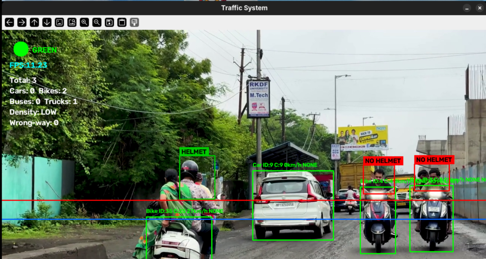
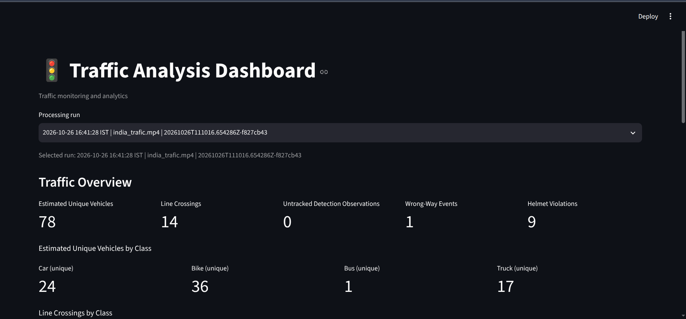
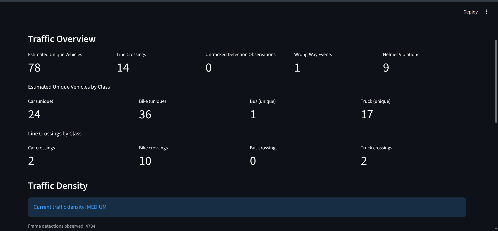
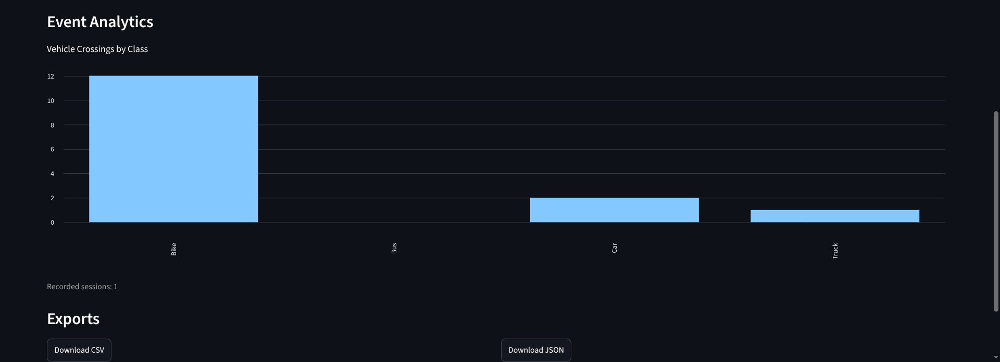
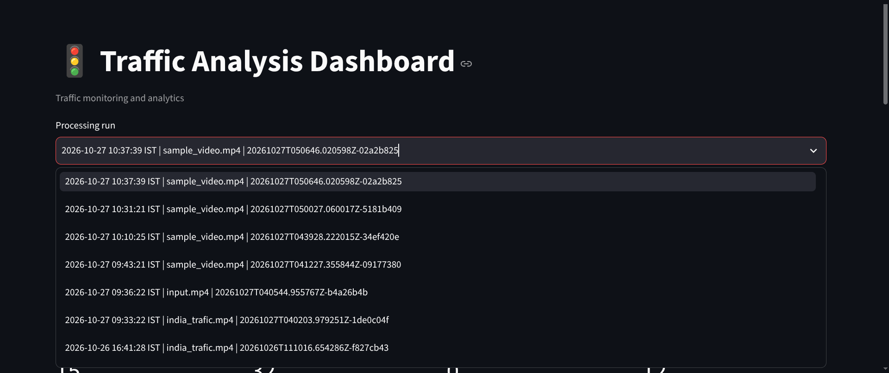

# Smart_traffic_Analysis_System

A deep-learning-based traffic video analysis project that combines vehicle detection, multi-object tracking, traffic analytics, event monitoring, and dashboard visualisation.

Developed as a course-based project for **Deep Learning (24AMLJ602)**, this system processes traffic video and generates structured information about vehicle movement, configured line crossings, selected traffic events, and traffic density.

> **Project status:** Academic prototype in development. Software functionality has been tested, but real-world detection, tracking, counting, and violation-detection accuracy still require validation against manually labelled traffic video.

## Overview

Manual traffic observation can be time-consuming and difficult to maintain consistently across long videos. This project explores how deep learning and computer vision can help automate selected traffic-analysis tasks.

The system processes video frames, detects supported vehicle categories, tracks vehicles across frames, applies traffic-event rules, stores analysis results, and presents completed-run statistics through a Streamlit dashboard.

The main objective is to integrate these stages into an understandable, modular, and testable workflow.

## Features

### Vehicle detection and tracking
- Detects supported vehicle categories using Ultralytics YOLOv8.
- Tracks vehicles across video frames using ByteTrack.
- Supports the configured categories **Car, Bike, Bus, and Truck**.
- Displays vehicle detections, tracker IDs, and processing information.

### Traffic analytics
- Records configured line-crossing events.
- Generates class-wise crossing statistics.
- Estimates vehicle direction and applies configurable wrong-way confirmation rules.
- Classifies traffic density using configured vehicle-count thresholds.
- Includes experimental vehicle re-identification to estimate unique vehicles across fragmented tracker identities.

### Helmet-related monitoring
- Includes a helmet-monitoring pipeline associated with motorcycle and rider observations.
- Applies implemented monitoring rules to flag potential helmet-related violations.
- Requires further validation against manually labelled video before its outputs can be interpreted as reliable violation measurements.

### Dashboard and reporting
- Provides a Streamlit dashboard for reviewing completed processing runs.
- Displays summary metrics, class-wise statistics, traffic-density information, and event analytics.
- Supports historical run selection through stored run history.
- Exports supported analytics data in CSV and JSON formats.

### Structured outputs and testing
- Stores events, statistics, and frame-level observations.
- Maintains a manifest of completed runs.
- Includes automated tests for analytics, event validation, exports, density classification, re-identification logic, run history, and related components.

## Technology stack

| Technology | Purpose |
|---|---|
| Python | Main implementation language |
| OpenCV | Video processing and frame handling |
| Ultralytics YOLOv8 | Vehicle detection |
| ByteTrack | Multi-object tracking |
| NumPy | Numerical and geometric operations |
| Streamlit | Interactive analytics dashboard |
| JSON and CSV | Event, statistics, and observation storage |
| pytest | Automated testing |
| Git and GitHub | Version control and project hosting |

## System architecture

```text
                   Traffic Video
                         |
                         v
                  OpenCV Processing
                         |
                         v
                   YOLOv8 Detection
                         |
                         v
                    ByteTrack
                         |
                         v
                 Traffic Analytics
                /        |         \
               v         v          v
          Crossings  Wrong-way   Helmet-related
                     monitoring   monitoring
                \        |         /
                 \       |        /
                         v
                Structured Run Outputs
                 JSON / CSV / Manifest
                         |
                         v
                 Streamlit Dashboard
             Metrics / Events / Run History
                         |
                         v
                   CSV / JSON Exports
```

The processing pipeline generates results for a particular run. The dashboard reads stored outputs, allowing completed analyses to be reviewed without reprocessing the source video every time.


## Project structure

The main project components, tests, and documentation are organised as follows:

```text
Smart_traffic_Analysis_System/
├── app/
│   ├── analytics/
│   ├── storage/
│   └── event_validation.py
├── contracts/
│   └── event_schema.json
├── dashboard/
│   └── app.py
├── docs/
│   └── images/
│       ├── live-detection.png
│       ├── dashboard-overview1.png
│       ├── dashboard-overview2.png
│       ├── event-analytics.png
│       └── run-history.png
├── samples/
│   └── sample_events.json
├── tests/
│   ├── test_analytics.py
│   ├── test_dashboard_exports.py
│   ├── test_density.py
│   ├── test_event_contract.py
│   ├── test_event_logger.py
│   ├── test_events.py
│   ├── test_exporter.py
│   ├── test_helmet_monitor.py
│   ├── test_helmet_rider.py
│   ├── test_metric_contract.py
│   ├── test_reid.py
│   ├── test_reid_integration.py
│   ├── test_rider_tracker.py
│   └── test_run_history.py
├── traffic_analysis/
│   ├── analytics.py
│   ├── events.py
│   ├── helmet_monitor.py
│   ├── helmet_rider.py
│   ├── reid.py
│   └── run_history.py
├── traffic_analyzer.py
├── requirements.txt
├── README.md
└── LICENSE
```

This is a high-level view of the repository; it omits some package files and individual tests.

## Requirements

- Python 3.12 is the development environment used for the project.
- Git
- Python dependencies listed in `requirements.txt`
- The required YOLO model weights
- A compatible traffic video file

Processing performance depends on the video resolution, model, and available hardware.

## Installation

### 1. Clone the repository

The repository currently uses this GitHub URL:

```bash
git clone https://github.com/Yusaf30/smart-traffic-analysis.git
cd smart-traffic-analysis
```

The directory and remote URL can be updated if the GitHub repository is renamed.

### 2. Create a virtual environment

**Linux / macOS**

```bash
python3 -m venv .venv
source .venv/bin/activate
```

**Windows PowerShell**

```powershell
py -3.12 -m venv .venv
.\.venv\Scripts\Activate.ps1
```

### 3. Install dependencies

```bash
python -m pip install --upgrade pip
python -m pip install -r requirements.txt
```

## Running the analysis

The main processing script is `traffic_analyzer.py`. The configured default video path is `india_trafic.mp4`.

### Use the default video

```bash
python traffic_analyzer.py
```

### Use a different video

**Linux / macOS**

```bash
VIDEO_PATH="/path/to/your/video.mp4" python traffic_analyzer.py
```

For headless processing:

```bash
VIDEO_PATH="/path/to/your/video.mp4" HEADLESS=1 python traffic_analyzer.py
```

To limit processing to a specific number of frames:

```bash
VIDEO_PATH="/path/to/your/video.mp4" \
HEADLESS=1 MAX_FRAMES=180 python traffic_analyzer.py
```

**Windows PowerShell**

```powershell
$env:VIDEO_PATH = "C:\path\to\your\video.mp4"
python traffic_analyzer.py
```

The counting line can be configured using `COUNT_LINE_Y`. Its default in the current implementation is `500`; the appropriate value depends on the video resolution and camera view.

## Launching the dashboard

With the project environment activated, run:

```bash
streamlit run dashboard/app.py
```

The dashboard reads stored processing results and displays information for available completed runs.

## Output files and run history

The processing pipeline stores results in run-specific directories under `outputs/runs/`.

Typical output files include:

| File | Description |
|---|---|
| `events.json` | Recorded traffic-event objects |
| `stats.json` | Summary statistics for a processing run |
| `frame_log.csv` | Frame-level detection, tracking, and analytics observations |
| `reid_frame_log.csv` | Experimental re-identification diagnostics |
| `run_manifest.json` | Index of completed runs |

The run-history module registers successfully completed runs in a manifest. This supports historical review and separates video processing from dashboard presentation.

## Understanding the results

Different dashboard metrics represent different measurements.

- **Line crossings:** Recorded crossing events based on the configured counting-line logic and tracker observations.
- **Estimated unique vehicles:** Experimental estimates that attempt to associate observations belonging to the same physical vehicle.
- **Tracker IDs:** Temporary identities generated by the tracking algorithm; these do not guarantee one stable identity per physical vehicle.
- **Traffic density:** A category derived from configured vehicle-count thresholds.
- **Wrong-way events:** Events recorded by the configured direction and confirmation rules.
- **Helmet-related events:** Potential violations flagged by the implemented monitoring pipeline.

A physical vehicle may receive multiple tracker IDs, and different vehicles may sometimes be associated incorrectly. For this reason, line-crossing counts, tracker-ID totals, and estimated unique-vehicle counts must not be treated as interchangeable.

## Testing

The project includes automated tests for its implemented software components.

Run the test suite from the repository root:

```bash
python -m pytest
```

The project report records a previous test run with **148 tests passed and 3 subtests passed**. This result was recorded during earlier testing and was not rerun while preparing this README.

Passing software tests demonstrates that the tested behaviours passed their assertions. It does not independently establish the real-world accuracy of vehicle detection, tracking, counting, wrong-way detection, or helmet-related monitoring.

## Screenshots

```text
docs/
└── images/
    ├── live-detection.png
    ├── dashboard-overview1.png
    ├── dashboard-overview2.png
    ├── event-analytics.png
    └── run-history.png
```

### Live Vehicle Detection

The system detects and tracks vehicles in traffic footage, displaying detections and tracking information.



### Dashboard Overview

The Streamlit dashboard presents traffic statistics, vehicle counts, and density information.





### Event Analytics

The analytics view displays vehicle crossings by class and provides CSV and JSON export options.



### Run History

The run selector lets users choose recorded processing runs and inspect the associated analytics.



## Limitations

The system is an academic prototype and has several limitations:

- Tracking may fragment when detections are lost or vehicles become occluded.
- Experimental re-identification may incorrectly associate or separate vehicles.
- Vehicle classifications may vary across frames.
- Wrong-way and helmet-related events may contain false positives or missed events.
- Traffic-density thresholds are implementation settings, not calibrated traffic-engineering standards.
- Speed estimation depends on perspective calibration and has not been established as quantitatively reliable.
- Performance and accuracy may vary with camera angle, lighting, resolution, occlusion, and traffic conditions.
- The source and licence of the traffic video used in the recorded project run have not been established in the project report.

The results should be reviewed as automated analysis outputs, not as ground-truth measurements or certified traffic-enforcement decisions.

## Future scope

Potential improvements include:

- Evaluating detection, classification, tracking, and event accuracy against manually labelled videos.
- Reducing tracker-ID fragmentation and incorrect vehicle associations.
- Improving line-crossing validation and duplicate-count prevention.
- Validating helmet-related monitoring and wrong-way detection.
- Calibrating and evaluating speed estimation.
- Improving CPU processing performance and memory usage.
- Extending historical comparisons, reporting, and dashboard exports.
- Expanding automated tests and technical documentation.

## Project philosophy

The project focuses on combining deep learning, computer vision, tracking, analytics, structured storage, and visualisation into an understandable workflow.

The objective is to build a system that can be demonstrated, tested, inspected, and improved incrementally, while clearly distinguishing implemented functionality from performance that still needs independent validation.

## License

This project is developed for educational and academic purposes.

Please review the license and attribution requirements of the original project and any third-party models, datasets, libraries, or code used as part of this system.
